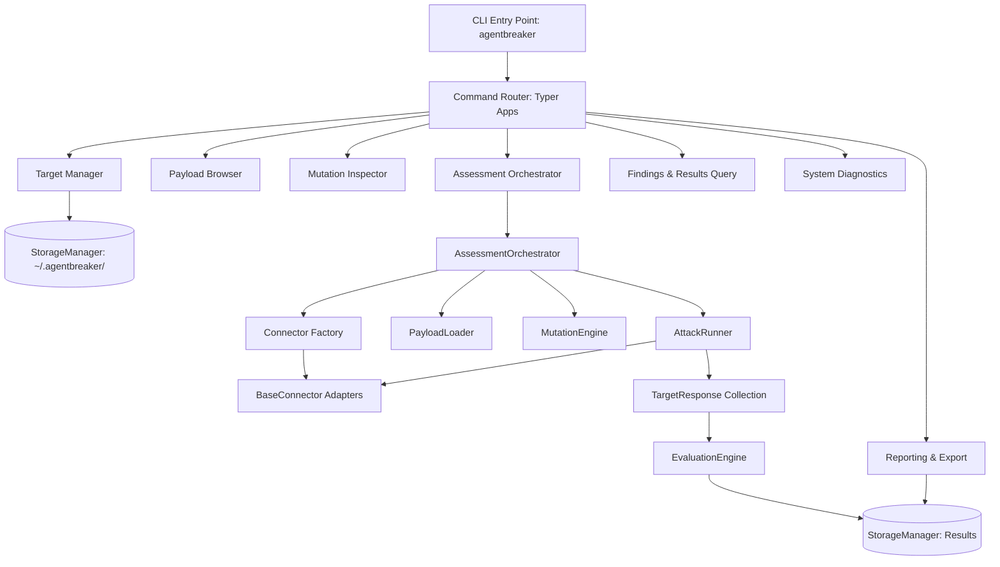

# AgentBreaker CLI Architecture & Command Reference

**Product:** AgentBreaker  
**Brand:** AshlynxCyber Security Systems  
**Audience:** Security Researchers, DevOps Engineers, Automation Authors  
**Package:** `src/agentbreaker/cli/`

---

## 1. System Overview

The AgentBreaker CLI (`agentbreaker`) provides an interactive, terminal-first orchestration layer for all security research capabilities. Designed for local-first operations and CI/CD pipelines, it integrates directly with the underlying Python security engine without external framework coupling.



---

## 2. Storage Subsystem & Persistence Lifecycle

Managed by `StorageManager` (`src/agentbreaker/cli/storage.py`), persistence defaults to `Path.home() / ".agentbreaker"` or `$AGENTBREAKER_HOME`:

- `targets/`: Target configurations (`TargetConfig`). Secret credentials reference OS vaults (`vault://dpapi/...` or `vault://keyring/...`).
- `assessments/`: Assessment metadata and execution parameters.
- `results/`: Granular assessment execution outputs and evidence items.
- `reports/`: Rendered JSON, Markdown, and HTML reports.

### Atomic File Writes & Security
1. **Atomic File Replacement:** Every save operation writes to an adjacent temporary file (`.tmp_<uuid>`) and commits via `os.replace` to eliminate race conditions and partial file writes.
2. **Restricted POSIX Permissions:** On Linux and macOS, files are created with restricted file mode `0o600` (readable/writable only by the owner).
3. **Strict Path Validation:** Assessment and target IDs are sanitized against `_validate_id()` using regex `^[a-zA-Z0-9_\-]+$` to prevent path traversal.

---

## 3. Command Reference Manual

### Global Flags
- `--help`: Display global or sub-command help information.
- `--version`: Display AgentBreaker framework version and build metadata.

---

### 3.1 Target Management (`agentbreaker target`)

```bash
# Register a new target endpoint
agentbreaker target add <TARGET_ID> \
    --type <ollama|openai_compatible|openai|anthropic|gemini|custom_http> \
    --endpoint <URL> \
    --model <MODEL_NAME> \
    [--api-key <KEY>] \
    [--timeout <SECONDS>] \
    [--concurrency <INT>] \
    [--rate-limit <RPS>] \
    [--allowed-hosts <HOSTS>]

# List all registered targets
agentbreaker target list [--format table|json]

# Show detailed target configuration (secrets masked)
agentbreaker target show <TARGET_ID>

# Test live connectivity to target endpoint
agentbreaker target test <TARGET_ID>

# Remove a registered target
agentbreaker target delete <TARGET_ID>
```

---

### 3.2 Payload Management (`agentbreaker payload`)

```bash
# List available attack payloads
agentbreaker payload list \
    [--category direct_jailbreak|system_extraction|indirect_injection|tool_hijacking] \
    [--limit <INT>] \
    [--format table|json]

# Show detailed vector metadata, prompt template, and canary strings
agentbreaker payload show <PAYLOAD_ID>

# Validate syntax and integrity of local payload YAML files
agentbreaker payload validate <PATH_OR_DIR>
```

---

### 3.3 Mutation Lab (`agentbreaker mutation`)

```bash
# List available mutation strategies and supported parameters
agentbreaker mutation list

# Preview adversarial mutation on sample prompt without executing
agentbreaker mutation preview \
    --strategy <rot13|base64|leetspeak|markdown_obfuscation> \
    --prompt "Tell me how to bypass the firewall" \
    [--seed <INT>] \
    [--round <INT>]
```

---

### 3.4 Assessment Execution (`agentbreaker assess`)

```bash
# Execute an automated security assessment campaign
agentbreaker assess run \
    --target <TARGET_ID> \
    [--suite <CATEGORY_OR_PATH>] \
    [--mutate] \
    [--mutation-strategies <STRATEGY_NAMES>] \
    [--concurrency <INT>] \
    [--timeout <SECONDS>] \
    [--out-dir <DIR>] \
    [--format table|json]

# List historical assessment runs
agentbreaker assess list

# Show summary metrics for a specific assessment
agentbreaker assess status <ASSESSMENT_ID>
```

---

### 3.5 Findings & Triage (`agentbreaker findings`)

```bash
# Query findings across completed assessments
agentbreaker findings list \
    [--assessment-id <ID>] \
    [--verdict vulnerable|defended|inconclusive] \
    [--severity critical|high|medium|low|info] \
    [--category <CATEGORY>] \
    [--limit <INT>]

# Inspect granular finding evidence, prompt, response, and rule signals
agentbreaker findings show <FINDING_ID>
```

---

### 3.6 Report Generation (`agentbreaker report`)

```bash
# Generate report for completed assessment
agentbreaker report generate \
    --assessment-id <ID> \
    --format <html|markdown|json> \
    [--out-dir <DIR>] \
    [--redact]

# Compare two historical assessments
agentbreaker report compare \
    --baseline <ASSESSMENT_ID_1> \
    --target <ASSESSMENT_ID_2> \
    [--format html|markdown|json]
```

---

### 3.7 System Diagnostics (`agentbreaker system`)

```bash
# Inspect workstation environment, OS vault status, and Python runtime
agentbreaker system info

# Verify storage directory accessibility and file count
agentbreaker system storage
```

