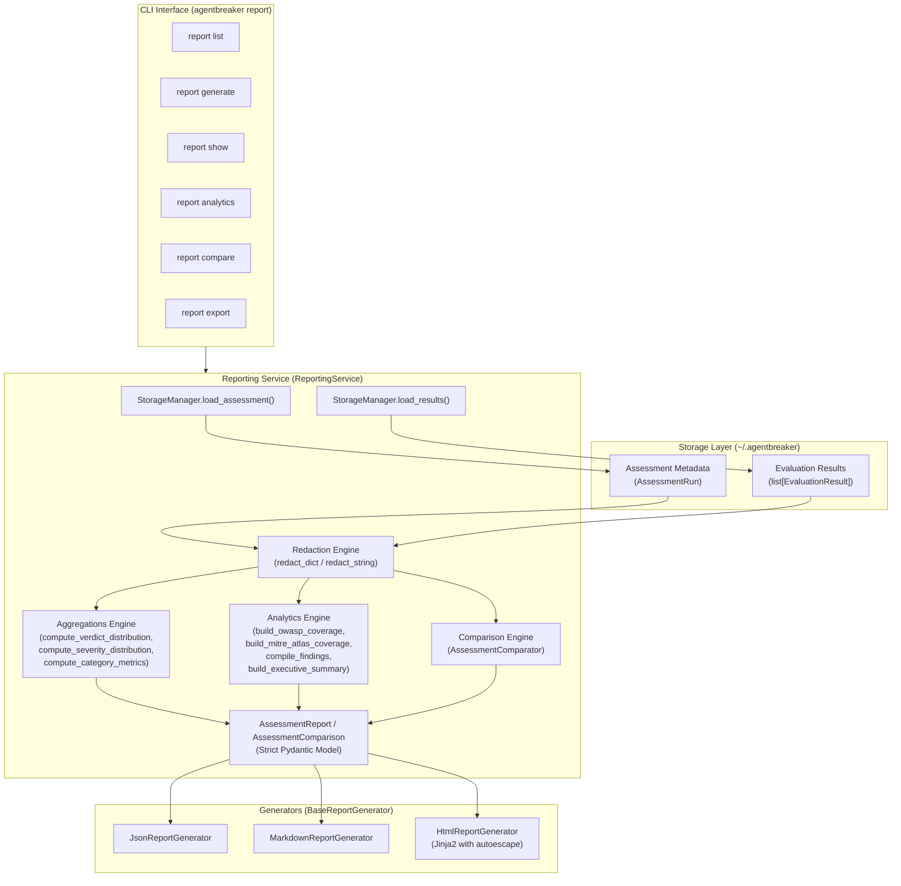

# AgentBreaker — Phase 7: Reporting & Analytics Architecture

**Document Version:** 1.0.0  
**Status:** Approved Architecture  
**Component:** Reporting & Analytics Subsystem (`agentbreaker.reporting`)  
**Maintainer:** AshlynxCyber Architecture & Engineering  

---

## 1. Architectural Overview

The **AgentBreaker Reporting & Analytics Engine** provides local-first, tamper-evident, reproducible analysis and document synthesis for adversarial AI evaluations. It translates stored assessment runs and evaluation verdicts into formal research artifacts in JSON, Markdown, and self-contained HTML formats.

The subsystem adheres to the following foundational engineering principles:

1. **Decoupled Separation of Concerns:** Analytics logic, statistical aggregations, data sanitization, document formatting, and disk persistence are strictly separated into dedicated functional modules.
2. **Local-First & Offline Resilience:** All computations and render operations occur locally without cloud telemetry or external network calls. HTML reports embed 100% of their stylesheets and scripts with zero external CDN dependencies.
3. **Defense-in-Depth Sanitization:** Centralized secret masking ensures API keys, tokens, and authorization credentials are redacted from all report representations. HTML rendering utilizes strict Jinja2 autoescaping to eliminate Cross-Site Scripting (XSS).
4. **Deterministic Reproducibility:** Reports derive strictly from immutable stored assessment results and evaluation verdicts produced by Phases 1–6 without retroactive modification.
5. **Path Traversal Resistance:** Canonical directory isolation enforces that exports and generated reports cannot write outside designated repository bounds or escape sandbox roots.

---

## 2. Component Pipeline Architecture

---

## 3. Subsystem Module Breakdown

### 3.1 Domain Models (`src/agentbreaker/reporting/models.py`)
Provides strict, validated Pydantic schemas representing all aggregated analytical entities:
- `ReportFormat`: StrEnum supporting `json`, `markdown`, and `html`.
- `VerdictDistribution`: Total tests, counts, and calculated rates for `Vulnerable`, `Defended`, and `Inconclusive`.
- `SeverityDistribution`: Vulnerability counts segmented by `Critical`, `High`, `Medium`, and `Low`.
- `CategoryMetric`: Attack-category vulnerability counts, defense rates, and inconclusive totals.
- `MutationMetrics`: Mutation lineage evaluation, comparing baseline payload success against mutated variants.
- `EvidenceMetrics`: Quantitative counts of canary leaks, regex matches, heuristic indicators, and tool violations.
- `OWASPRecord` & `MitreAtlasRecord`: Industry framework mappings with tested/untested status and defense rates.
- `FindingDetail`: Granular finding records containing payload ID, category, severity, evidence, reasoning, and reproduction prompt.
- `ExecutiveSummary`: High-level strategic briefing with purpose, scope, findings overview, and remediation priorities.
- `AssessmentReport`: Complete unified report object containing all above components.
- `AssessmentComparison`: Multi-assessment regression and progression analysis model.

### 3.2 Secret Redaction & Path Validation (`src/agentbreaker/reporting/redaction.py`)
- `redact_string(text)`: Pattern-based masking for standard API keys (e.g., `sk-...`, `Bearer ...`, `token=...`) and user-supplied credentials.
- `redact_dict(data)`: Recursive dictionary redaction for sensitive keys (`api_key`, `secret`, `authorization`, `password`, `token`).
- `escape_html(text)`: Explicit HTML escaping converting `<, >, &, ", '` into entities.
- `validate_report_path(path, base_dir, allow_outside)`: Validates that output file paths do not contain null bytes (`\0`) or traverse above approved directories.

### 3.3 Statistical Aggregations (`src/agentbreaker/reporting/aggregations.py`)
Statistically aggregates empirical results from lists of `EvaluationResult`:
- `compute_verdict_distribution(results)`: Computes counts and percentages with safe zero-division handling.
- `compute_severity_distribution(results)`: Counts confirmed vulnerabilities across severity ratings.
- `compute_category_metrics(results)`: Groups results by attack category to identify domain-specific weaknesses.
- `compute_mutation_metrics(results)`: Segregates baseline payloads from mutated variants, computing mutation efficacy.
- `compute_evidence_metrics(results)`: Sums empirical evidence indicators across the run.

### 3.4 Framework Analytics & Findings Compiler (`src/agentbreaker/reporting/analytics.py`)
- `build_owasp_coverage(results)`: Maps evaluated test categories to the OWASP Top 10 for LLM Applications (2025). Explicitly flags untested categories with research limitation notes.
- `build_mitre_atlas_coverage(results)`: Maps categories to MITRE ATLAS attack techniques (e.g., AML.T0054 Jailbreak, AML.T0051 Prompt Injection).
- `compile_findings(results)`: Extracts actionable `FindingDetail` records for confirmed vulnerabilities, including reproduction instructions and evidence summaries.
- `build_executive_summary(target_id, target_model, results, verdicts, severities)`: Synthesizes high-level findings, risk classifications, verified compromises, and prioritized remediation actions.

### 3.5 Comparative Analysis Engine (`src/agentbreaker/reporting/comparison.py`)
- `AssessmentComparator.compare(reports, labels)`: Compares two or more assessment reports.
- Computes verdict deltas across runs.
- Identifies **Resolved Vulnerabilities** (vulnerable in prior run, defended in subsequent run).
- Identifies **New Vulnerabilities** (defended or untested in prior run, vulnerable in subsequent run).
- Identifies **Persistent Vulnerabilities** (vulnerable across multiple runs).
- Generates compatibility warnings if target models, endpoints, or evaluation scopes differ.

### 3.6 Report Generation Engine (`src/agentbreaker/reporting/generators/`)
- `BaseReportGenerator`: Abstract base class declaring the `generate(report) -> str` contract.
- `JsonReportGenerator`: Generates formatted, schema-compliant JSON reports.
- `MarkdownReportGenerator`: Produces GitHub-Flavored Markdown reports complete with visual tables, badge syntax, and reproduction steps.
- `HtmlReportGenerator`: Compiles self-contained HTML documents using Jinja2 templates (`report.html.j2`, `executive_summary.html.j2`, `technical_findings.html.j2`) styled according to the Ashlynx technical workstation design system. Strict autoescaping (`select_autoescape(["html", "htm", "xml"])`) prevents template injection and XSS.

### 3.7 Orchestrating Service (`src/agentbreaker/reporting/service.py`)
- `ReportingService`: Encapsulates end-to-end report lifecycles:
  - `build_report(assessment_id)`: Loads raw data via `StorageManager`, compiles analytics, and constructs an `AssessmentReport`.
  - `generate_report(assessment_id, format, force_rebuild)`: Builds and renders report content.
  - `save_report(assessment_id, format, output_path)`: Atomically saves rendered reports to disk with directory validation.
  - `list_reports(assessment_id)`: Inspects existing reports on disk.
  - `compare_assessments(assessment_ids, labels)`: Orchestrates comparative analysis across assessments.

---

## 4. CLI Presentation Layer (`src/agentbreaker/cli/commands/report.py`)

The reporting CLI exposes rich, interactive terminal commands:
- `agentbreaker report list [assessment_id]`: Lists generated reports.
- `agentbreaker report generate <assessment_id> [--format json|markdown|html]`: Compiles and caches reports on disk.
- `agentbreaker report show <assessment_id>`: Displays an interactive Rich terminal dashboard with executive metrics, verdict breakdown, severity distribution, and findings.
- `agentbreaker report analytics <assessment_id>`: Displays detailed framework coverage tables for OWASP LLM Top 10 and MITRE ATLAS.
- `agentbreaker report compare <id_1> <id_2>`: Compares two assessment runs, highlighting progression, regressions, and resolved vulnerabilities.
- `agentbreaker report export <assessment_id> -o <path> [--format json|markdown|html]`: Directly exports reports to a designated path with overwrite protection and path traversal checks.

---

## 5. Security & Safety Controls

| Threat Vector | Mitigation Strategy | Implementation |
|---|---|---|
| **Secret Exposure** | Redaction applied before metric calculation and serialization | `redact_string`, `redact_dict` |
| **Cross-Site Scripting (XSS)** | Mandatory Jinja2 autoescaping on all dynamic values in HTML templates | `select_autoescape`, `escape_html` |
| **Directory Traversal** | Resolution against base directories, rejection of null bytes (`\0`) | `validate_report_path` |
| **External Resource Injection** | Embedded CSS styling, no external script or font requests | Standalone Jinja2 templates |
| **Data Inconsistency** | Reports derive strictly from immutable stored assessment results | Read-only loading via `StorageManager` |
| **Atomic Overwrites** | Reports written via temporary files replaced atomically | Temporary file write + atomic rename |

